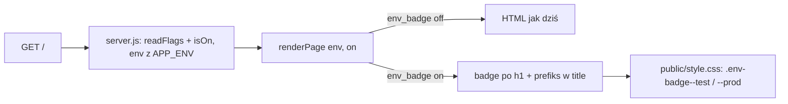

# Architektura zmiany CHG-4

## TL;DR
Znacznik środowiska i prefiks `<title>` powstają w `renderPage` (`src/page.js`) z `env` serwera, tylko gdy `on('env_badge')`.
Przy fladze off oba fragmenty są pustym łańcuchem doklejonym w miejscu, które nie zmienia szablonu, więc HTML jest bajt w bajt
jak dziś. Styl: trzy reguły w `public/style.css`. Flaga: wpis w obu plikach flag. Bez zmian w `src/server.js`, bez zależności,
bez JS klienta, CSP bez zmian. Wariant B zatwierdzony: CHG-4/D2 (DEC-0019); wymagania przyjęte: CHG-4/D3 (DEC-0020).

## Czynniki i ograniczenia
| Czynnik | Źródło |
|---|---|
| Znacznik TEST i PROD, różne kolory, tekst nośnikiem znaczenia, prefiks w `<title>`, flaga `env_badge` | CHG-4/D2 (DEC-0019), FR-001, FR-002 |
| Flaga off = strona identyczna jak dziś (kryterium porażki a) | CHG-4/D2, FR-003, NF-002 |
| Kontrast tekstu znacznika ≥ 4,5:1 (kryterium porażki b) | CHG-4/D2, FR-004, NF-003 |
| Znacznik zawsze zgodny z `APP_ENV`, nigdy z parametru żądania | NF-004, E-01C |
| Brak zależności (DL4), brak JS klienta, CSP `default-src 'self'` (bez stylów inline) | intent.md, NF-005 |
| Pomiar skutku: przegląd zgłoszeń przez właściciela po 4 tygodniach, cel zero pomyłek | CHG-4/D2, NF-007 (poza kodem) |

## Rozwiązanie

Zmiany w istniejących modułach (stan sprawdzony w `src/page.js`, `src/server.js`, `src/flags.js`):
1. `src/page.js` — dwie zmienne obliczane obok `counter`/`banner`/`footer`:
   - `badge = on('env_badge') ? \` ${escape(String(env).toUpperCase())}\` : ''`
   - `titlePrefix = on('env_badge') ? \`[${escape(String(env).toUpperCase())}] \` : ''`
   - szablon: `<title>${titlePrefix}sdlc-sandbox</title>` oraz `<h1>sdlc-sandbox</h1>${badge}` (badge **doklejony do linii `<h1>`**,
     bez nowej linii szablonu). Przy off oba wstawienia dają `''`, więc wynik jest bajt w bajt jak dziś (ADR-1).
     Pozycja: znacznik po `<h1>`, przed `${banner}` i akapitem „Środowisko” (E-01D). Akapit „Środowisko: …” zostaje (FR-001).
2. `public/style.css` — `.env-badge` (padding, `border-radius`, `font-weight`, `font-size`, kolor tekstu), `.env-badge--test`
   i `.env-badge--prod` (różne tła). Element w przepływie dokumentu (`display: inline-block`), nie `position: fixed`. Bez stylów inline.
   Kolory **[propozycja]**: TEST — biały tekst na `#1d4ed8` (niebieski), PROD — biały tekst na `#b91c1c` (czerwony); kontrast
   liczy test E-04A z wartości w pliku (nie z pamięci), więc ewentualna korekta kolorów nie zmienia planu.
3. `config/flags.test.json`: `env_badge` `{ "enabled": true, "rollout": 100 }`; `config/flags.prod.json`: `{ "enabled": false, "rollout": 0 }`
   (FR-005; włączenie na prod to etap rolloutu, nie część TSK-1). Brak klucza w starym pliku = flaga off (`isOn`, E-05C).

Nie zmieniamy: `src/server.js` (`on` i `env` już trafiają do `renderPage`), `src/flags.js`, bazy, `/deployments`, nagłówka CSP.
Wartość klasy `env-badge--${env}` przechodzi przez `escape`; `env` pochodzi wyłącznie z `APP_ENV` (`createServer({ env })`).

## Atrybuty jakości — jak spełnione
| Atrybut | Mechanizm | Weryfikacja |
|---|---|---|
| Brak regresji (NF-002) | wstawki `''` doklejone w liniach, które już istnieją (`<title>`, `<h1>`) | E-03A (porównanie z HTML sprzed zmiany, dla `test` i `prod`), E-03B |
| Wiarygodność (NF-004) | tekst i prefiks z `env` serwera, nie z `URL` | E-01A–C, E-02A–B |
| Dostępność (NF-003) | tekst zawsze obecny, kontrast liczony w teście | E-04A, E-04B |
| Bezpieczeństwo (NF-001, NF-005) | `escape` na każdej wartości, brak inline i JS | test z `env` zawierającym `<`; E-04C |

## ADR-1 — Znacznik i prefiks doklejone do istniejących linii szablonu
- **Status:** proposed
- **Kontekst:** FR-003 wymaga HTML bajt w bajt jak dziś przy fladze off. `banner` i `footer` mają własne linie szablonu i przy off
  zostawiają puste linie, więc osobna linia na znacznik złamałaby kryterium porażki (a) z CHG-4/D2.
- **Opcje:** A — `${badge}` doklejony do linii `<h1>` i `${titlePrefix}` w `<title>` (wybór); B — osobna linia `${badge}` w szablonie,
  przy off `.replace` pustej linii (kruche); C — drugi szablon dla strony ze znacznikiem (duplikacja HTML, rozjazd z szablonem podstawowym).
- **Decyzja:** A. Test E-03A porównuje wynik z zamrożonym HTML sprzed zmiany.
- **Konsekwencje:** szablon wygląda nieco inaczej niż `banner`/`footer`; komentarz w kodzie podaje powód (wzór: CHG-3/ADR-2).
  CHG-3 zmieniał tę samą funkcję (`counter` w linii „Środowisko”): brak konfliktu logicznego, możliwy konflikt tekstowy przy scalaniu.

## ADR-2 — Znacznik w nagłówku renderowany po stronie serwera, styl w pliku, bez favicony
- **Status:** proposed (wariant B z prefiksem w `<title>` zatwierdzony: CHG-4/D2, DEC-0019)
- **Kontekst:** CSP `default-src 'self'` blokuje style i skrypty inline; serwer podaje dziś statycznie tylko `/style.css`.
- **Opcje:** A — klasy w `style.css` + SSR (wybór); B — znacznik wstawiany skryptem klienta po `APP_ENV` z `/health` (JS, CSP, błysk
  strony bez znacznika, zależność od drugiego żądania); C — favicon zależny od środowiska (nowy routing statyczny, poza zakresem intentu).
- **Decyzja:** A. Znacznik jest w pierwszym HTML, więc widać go bez JS i w podglądzie, a środowisko nie zależy od drugiego żądania.
- **Konsekwencje:** dwa kolory w jednym pliku CSS; zmiana kolorów wymaga ponownego sprawdzenia kontrastu (test E-04A robi to automatycznie).

## ADR-3 — Brak testów mutacyjnych w celach zmiany
- **Status:** proposed (próg do potwierdzenia na B3, pytanie niżej)
- **Kontekst:** N4 zaleca próg mutacji na zmienionym kodzie, ale narzędzie (StrykerJS) to nowa zależność, a DL4 zakazuje zależności.
  Zmieniony kod to kilka linii, w całości sprawdzanych testami na dokładny wynik (porównanie HTML, nie tylko „zawiera”).
- **Decyzja:** w `targets` tylko pokrycie zmienionych linii; mutacji nie stawiamy. Jakość testów pilnują asercje na dokładny HTML
  i test „flaga off = HTML sprzed zmiany”. Odwracalne: próg można dodać, gdy projekt przyjmie narzędzie.

## Wydanie i bezpieczeństwo wdrożenia
Jedno cięcie TSK-1 za flagą `env_badge` (plan.md, release.yaml). Start: test on, prod off. Włączenie na prod to etap rolloutu
decydowany przez właściciela flagi (znacznik na prod widzą wszyscy odwiedzający, to świadoma decyzja CHG-4/D2). Wycofanie:
`enabled: false` w `config/flags.prod.json`, bez rollbacku kodu. Kryterium porażki (a) pilnuje E-03A/B, kryterium (b) — E-04A.

## Ryzyka
| Ryzyko | Reakcja |
|---|---|
| Rozjazd HTML przy off (np. dodatkowy znak nowej linii) | E-03A porównuje z HTML sprzed zmiany dla obu środowisk |
| Znacznik pokazuje złe środowisko | `env` tylko z `APP_ENV`; E-01C z `?env=test` na serwerze `prod` |
| Zmiana kolorów obniży kontrast | E-04A liczy kontrast z pliku CSS; test czerwony przy < 4,5 |
| Konflikt tekstowy z CHG-3 w `src/page.js` i plikach flag | rebase przed delivery; zmiany dotyczą innych linii szablonu |
| Narzędzie pokrycia nie liczy „zmienionych linii” | sprawdzenie ręczne: raport `--experimental-test-coverage` dla `src/page.js`, brak niepokrytych linii w diffie **[założenie]** |

## Pytania do bramki
- Właściciel aplikacji sdlc-proba: kto jest właścicielem flagi `env_badge` (decyduje o przejściu etapów rolloutu, w tym o włączeniu znacznika na prod) i czy `remove_by: 2027-03-31` w release.yaml (propozycja Tomasza) jest właściwą datą usunięcia flagi?
- Właściciel aplikacji sdlc-proba: jakie kryterium wyjścia z etapu `test` przed włączeniem na prod (propozycja w release.yaml: min. 3 dni na test, znacznik „TEST” widoczny, `<title>` z prefiksem, zero błędów 5xx w logu serwera)?
- Właściciel aplikacji sdlc-proba: czy akceptujecie brak progu testów mutacyjnych (ADR-3, powód: StrykerJS to nowa zależność wbrew DL4), a jako jedyny próg jakości kodu pokrycie zmienionych linii ≥ 90%?

## Przekazanie
Następny krok: faza design (wygląd znacznika: kolory, rozmiar, odstęp od `<h1>`; pozycja i tekst już ustalone tutaj i w FR-001/FR-002),
potem delivery TSK-1 metodą TDD, testy E-01A…E-05C pisane najpierw (czerwone przed kodem).
