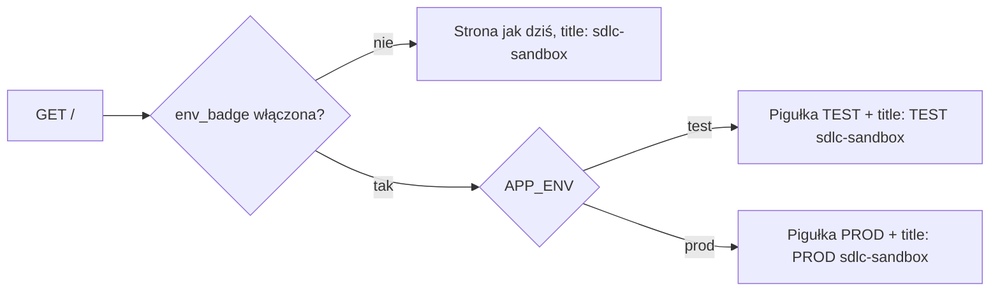

# Projekt zmiany CHG-4

## TL;DR
Znacznik „TEST" albo „PROD" to pigułka z tekstem w przepływie dokumentu, tuż pod `<h1>`, w innym kolorze dla każdego
środowiska; prefiks `[TEST]`/`[PROD]` w `<title>`. Tekst niesie znaczenie, kolor je wzmacnia. Ramek Figmy nie ma
(brak pliku i połączenia z Figma MCP w tej sesji): wiersze mają `brak` z pytaniem do projektanta, szkicu ramek nie
tworzyłam, bo nikt o niego nie prosił. Ustalenia z bramek: wariant B i flaga `env_badge` (CHG-4/D2, DEC-0019),
wymagania (CHG-4/D3, DEC-0020), plan (CHG-4/D4, DEC-0021).

Plik Figmy: brak (nie podano linku) · tryb: dopasowanie ramek projektanta (szkic ramek przez agenta tylko na prośbę człowieka)

## Ramki per wymaganie i stan

Format z kontraktu pdi (`conventions.design`). Strona jest statyczna, renderowana na serwerze, bez formularzy i bez
wywołań z klienta, więc stany ładowania i błędu sieci nie występują; stan błędu to `server_error` (serwer nie zwraca
strony), obsługiwany poza zakresem tej zmiany.

| Wymaganie | Ścieżka | Stan | Ramka | Uwagi |
|---|---|---|---|---|
| US-01 | Tester otwiera `GET /` na `test`, flaga `env_badge` włączona | idle | brak | Pytanie do projektanta: ramka strony z pigułką „TEST" (żółte tło, ciemny tekst) i kartą `[TEST] sdlc-sandbox`; FR-001, FR-002, FR-004 |
| US-01 | Tester otwiera `GET /` na `prod`, flaga włączona | success | brak | Pytanie do projektanta: ramka z pigułką „PROD" (czerwone tło, biały tekst) i kartą `[PROD] sdlc-sandbox`; rozpoznanie środowiska bez czytania adresu |
| US-01 | Flaga `env_badge` wyłączona (prod do czasu rollout) | idle | brak | Pytanie do projektanta: ramka referencyjna = dzisiejsza strona bez zmian (FR-003, bajt w bajt); wystarczy zrzut obecnej strony |
| US-01 | Brak odpowiedzi serwera przy `GET /` | server_error | nie dotyczy | Strony nie renderuje serwer, więc znacznika nie ma; błąd obsługuje przeglądarka, poza zakresem CHG-4 |
| FR-001 | Znacznik w nagłówku, wąski ekran (≈ 320 px) | idle | brak | Pytanie do projektanta: ramka mobilna; pigułka nie zawija się i nie wychodzi poza `main` |
| FR-001 | Znacznik w nagłówku przy włączonej fladze | success | brak | Pytanie do projektanta: ramka desktop z kolejnością `<h1>` → pigułka → akapit „Środowisko" (E-01D) |
| FR-001 | Środowisko spoza `test`/`prod` albo błędna wartość | validation_error | nie dotyczy | `APP_ENV` dopuszcza tylko `test` i `prod` (`ENVIRONMENTS`, `src/flags.js`); znacznik nie przyjmuje danych z żądania (NF-004) |
| FR-004 | Para kolorów test i prod | idle | brak | Pytanie do projektanta: karta tokenów kolorów; wartości poniżej są propozycją, kontrast liczy test E-04A |
| FR-004 | Kontrast obu wariantów ≥ 4,5:1 | success | brak | Pytanie do projektanta: ramka z zapisem kontrastu; sprawdzenie w teście, nie w Figmie |
| FR-004 | Kontrast poniżej 4,5:1 | validation_error | nie dotyczy | To kryterium porażki (CHG-4/D2), wyłapuje je test E-04A przed wydaniem, nie ma ekranu błędu |

## Przepływy

Zasady wyglądu (propozycja do potwierdzenia przez projektanta, realizacja w `public/style.css`, bez stylów inline):

| Element | TEST | PROD |
|---|---|---|
| Tekst | „TEST", wielkie litery, pogrubiony | „PROD", wielkie litery, pogrubiony |
| Tło / tekst | `#ffd54f` / `#1d1d1f` (kontrast ok. 11,9:1 **[obliczone ręcznie, niezweryfikowane skryptem]**) | `#b3261e` / `#ffffff` (ok. 6,5:1 **[obliczone ręcznie, niezweryfikowane skryptem]**) |
| Kształt | pigułka `display: inline-block`, padding `.25rem .75rem`, `border-radius: 999px`, rozmiar tekstu `.875rem`, odstęp pod `<h1>` `.5rem` | jak TEST |
| Położenie | w przepływie dokumentu, pod `<h1>`, nad akapitem „Środowisko"; bez `position: fixed` | jak TEST |

- Znaczenie nie zależy od koloru: tekst jest zawsze obecny (WCAG 1.4.1); osoby bez rozróżniania barw czytają „TEST"/„PROD".
- Pigułka to zwykły ``, bez roli ARIA i bez `aria-label`: czytnik odczyta tekst „TEST"/„PROD" w kolejności dokumentu.
- Prefiks `<title>` stoi na początku, więc jest widoczny nawet na wąskiej karcie i na liście okien.
- Akapit „Środowisko: …" zostaje (FR-001), więc istniejące testy strony nie wymagają zmian.
- Ruch, animacje i zmiany po stronie klienta: brak (NF-005).

## Pytania do bramki
- Projektant (właściciel pliku Figmy): podaj link do pliku Figmy i ramki (z `node-id`) dla wierszy z `brak`, albo zdecyduj, że ramki ma naszkicować agent; do tego czasu wiersze zostają bez ramek.
- Projektant: czy kolory (`#ffd54f`/`#1d1d1f` dla TEST, `#b3261e`/`#ffffff` dla PROD), rozmiar i kształt pigułki z sekcji „Przepływy" są zgodne z systemem projektowym sdlc-sandbox?
